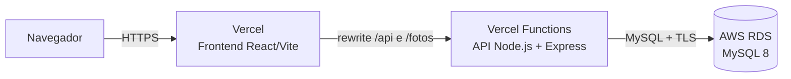
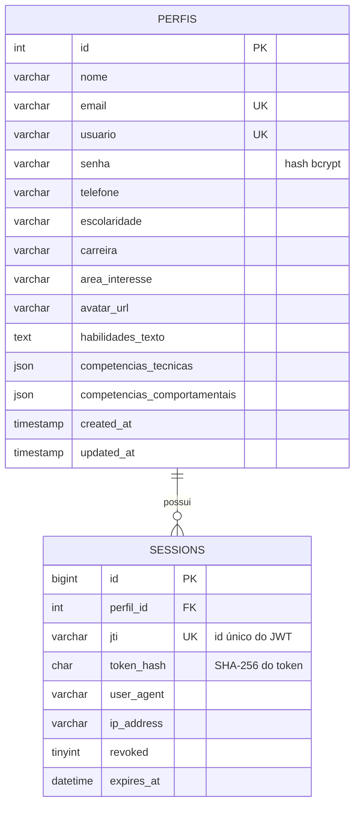

# Emprega Brasil

Plataforma web que ajuda candidatos a se prepararem para o mercado de trabalho: o usuário cria uma conta, monta o próprio perfil profissional, consulta dicas de currículo e acessa as principais plataformas de vagas do país.

> Projeto acadêmico — curso de **Análise e Desenvolvimento de Sistemas (ADS) · FATEC**
> Integrantes: _preencher_ · Disciplina: _preencher_ · Professor(a): _preencher_

**Em produção:** https://emprega-brasil-web-five.vercel.app
**Documentação interativa da API (Swagger):** https://emprega-brasil-api-murex.vercel.app/api/docs

---

## Sumário

1. [Visão geral](#1-visão-geral)
2. [Funcionalidades](#2-funcionalidades)
3. [Arquitetura](#3-arquitetura)
4. [Tecnologias](#4-tecnologias)
5. [Estrutura do repositório](#5-estrutura-do-repositório)
6. [Modelo de dados](#6-modelo-de-dados)
7. [Autenticação e segurança](#7-autenticação-e-segurança)
8. [API REST](#8-api-rest)
9. [Decisões de projeto](#9-decisões-de-projeto)
10. [Como executar](#10-como-executar)
11. [Deploy](#11-deploy)
12. [Limitações conhecidas e próximos passos](#12-limitações-conhecidas-e-próximos-passos)
13. [Roteiro sugerido para a apresentação](#13-roteiro-sugerido-para-a-apresentação)

---

## 1. Visão geral

| | |
|---|---|
| **Problema** | Candidatos, especialmente os iniciantes, não sabem por onde começar: como montar um currículo, onde procurar vagas e como organizar suas competências. |
| **Solução** | Uma aplicação web responsiva e simples, com conta pessoal, perfil profissional editável e conteúdo de apoio. |
| **Público** | Pessoas em busca da primeira oportunidade ou de recolocação. |

O sistema segue o modelo **cliente–servidor** com uma **SPA** (Single Page Application) no front-end, uma **API REST** no back-end e um **banco relacional** gerenciado na nuvem.

## 2. Funcionalidades

| Página | Rota | Acesso | O que faz |
|---|---|---|---|
| Página inicial | `/` | Público | Apresenta o propósito do projeto e atalhos para as seções. |
| Cadastro | `/cadastro` | Visitante | Cria a conta (nome, e-mail, usuário, senha) e já inicia a sessão. |
| Login | `/login` | Visitante | Autentica por e-mail ou usuário e senha. |
| Perfil | `/perfil` | Logado | Visualiza e edita dados pessoais, escolaridade, carreira, área de interesse, habilidades, competências técnicas e comportamentais (a foto está em desenvolvimento). |
| Currículo | `/curriculo` | Público | Dicas práticas para estruturar um bom currículo. |
| Vagas | `/vagas` | Público | Lista de plataformas de emprego (LinkedIn, Gupy, Catho, etc.) com links diretos. |

Regras de navegação: visitantes logados não veem Login/Cadastro (`GuestRoute`) e usuários não logados são redirecionados ao tentar abrir o Perfil (`ProtectedRoute`).

## 3. Arquitetura



**Fluxo de uma requisição (ex.: login):**

1. O usuário envia o formulário; o React chama `POST /api/auth/token` pelo mesmo domínio do site.
2. A Vercel encaminha `/api/*` para a função do back-end (rewrite).
3. A API valida os dados, confere a senha com **bcrypt**, gera um **JWT**, registra a sessão no banco e devolve o token.
4. O front guarda o token e o envia no cabeçalho `Authorization: Bearer …` nas próximas chamadas.

### Back-end em camadas

```
Requisição → routes → middlewares (JWT, validação, upload)
          → controllers → services → repositories → MySQL
```

| Camada | Responsabilidade |
|---|---|
| `routes` | Define URLs e a ordem dos middlewares; contém a documentação OpenAPI. |
| `middlewares` | Autenticação JWT, validação de entrada, upload de imagem, tratamento de erros. |
| `controllers` | Traduz HTTP em chamadas de serviço e devolve o status correto. |
| `services` | Regras de negócio (hash de senha, emissão de token, conflito de e-mail). |
| `repositories` | Único lugar com SQL; usa consultas parametrizadas. |
| `config` | Variáveis de ambiente, pool do banco e Swagger. |

### Front-end

- **Páginas** (`pages/`) compõem **componentes** reutilizáveis (`components/`).
- **Contexto de autenticação** (`context/AuthProvider`) guarda o usuário e expõe `login`, `register`, `logout` por meio do hook `useAuth`.
- **Serviços** (`services/`) isolam as chamadas HTTP (`axios`) e a persistência do token.
- Um **interceptor** do axios anexa o token e, ao receber 401 com token enviado, encerra a sessão automaticamente.

## 4. Tecnologias

| Área | Tecnologia | Uso |
|---|---|---|
| Front-end | React 19, Vite, React Router, Axios | SPA, rotas, chamadas à API |
| Back-end | Node.js 22, Express 4 | API REST |
| Banco | MySQL 8 no **AWS RDS** | Persistência |
| Segurança | bcryptjs, jsonwebtoken, cors, TLS | Senhas, sessão, origem, transporte |
| Upload | multer | Middleware de foto de perfil (JPG/PNG, até 5 MB) — implementado, ainda não ligado à rota |
| Documentação | swagger-jsdoc, swagger-ui-express | OpenAPI em `/api/docs` |
| Contêineres | Docker, Docker Compose, nginx | Execução local e imagens |
| Orquestração | Kubernetes (manifests em `k8s/`) | Deploy alternativo em cluster |
| Hospedagem | Vercel (front e API) | Deploy de produção |

## 5. Estrutura do repositório

```
.
├── backend/ms-profile/        # API (microsserviço de perfil)
│   ├── api/index.js           # entrada serverless da Vercel
│   ├── server.js              # entrada para execução tradicional (Docker/local)
│   ├── src/                   # routes, controllers, services, repositories, middlewares, config
│   ├── certs/                 # bundle de CA da AWS (validação TLS do RDS)
│   ├── docker/mysql/init.sql  # criação do schema
│   └── vercel.json
├── frontend/                  # SPA React
│   ├── src/                   # pages, components, context, services, routes, stylesheet
│   ├── Dockerfile · nginx.conf
│   └── vercel.json            # rewrites /api e SPA fallback
├── k8s/                       # manifests Kubernetes
├── docker-compose.yml         # sobe front + API (+ MySQL local opcional)
└── deploy_vercel.sh           # deploy automatizado na Vercel
```

## 6. Modelo de dados



- `perfis` guarda a conta e o perfil profissional. As competências são colunas **JSON**, o que evita criar tabelas auxiliares para listas simples.
- `Sessions` permite **revogar** tokens (logout). Ela se relaciona com `perfis` por chave estrangeira com `ON DELETE CASCADE`.
- Todo o schema está em `backend/ms-profile/docker/mysql/init.sql`.

## 7. Autenticação e segurança

| Mecanismo | Como funciona |
|---|---|
| **Senhas** | Nunca são guardadas em texto: usa-se bcrypt com custo 12. Tamanho aceito: 8 a 72 caracteres. |
| **Login** | Endpoint `POST /api/auth/token` no estilo OAuth 2.0 (*password grant*), formato `application/x-www-form-urlencoded`. |
| **JWT** | Assinado com HS256; contém o id do perfil (`sub`) e um identificador único (`jti`). Expira em 1 h. |
| **Sessão revogável** | O servidor guarda o `jti` e o hash SHA-256 do token. O logout marca a sessão como revogada, e a partir daí o token deixa de valer mesmo antes de expirar. |
| **Autorização** | Cada usuário só acessa o próprio perfil (`/perfis/me`); pedir outro id retorna 403. |
| **CORS** | Lista de origens permitidas por variável de ambiente. Na produção a API é servida pelo mesmo domínio do front, então o navegador nem precisa de CORS. |
| **Transporte** | Conexão com o RDS por TLS, validando o certificado com a CA oficial da AWS (`rejectUnauthorized: true`). |
| **SQL Injection** | Todas as consultas são parametrizadas. |
| **Upload** | O middleware `uploadFoto` já restringe a JPG/PNG, limite de 5 MB e nome gerado pelo servidor, mas **ainda não está ligado a nenhuma rota** (ver seção 12). |
| **Segredos** | `.env` fora do Git; apenas `.env.example` é versionado. |

## 8. API REST

Base: `/api` · Documentação completa e testável em `/api/docs`.

| Método | Rota | Auth | Descrição |
|---|---|---|---|
| GET | `/health` | Não | Verifica se a API está no ar. |
| POST | `/auth/register` | Não | Cria conta. Retorna 409 se e-mail ou usuário já existirem. |
| POST | `/auth/token` | Não | Login. Retorna `access_token`, `expires_in` e dados básicos do perfil. |
| POST | `/auth/logout` | Sim | Revoga a sessão atual (204). |
| GET | `/perfis/me` | Sim | Retorna o perfil do usuário logado. |
| PUT/PATCH | `/perfis/me` | Sim | Atualiza o perfil (corpo JSON). O envio de foto ainda não está ligado à rota (ver seção 12). |
| GET | `/perfis/me/:id` | Sim | Retorna o perfil apenas se o `id` for o do próprio usuário. |

Códigos usados: `200/201/204` sucesso · `400` dados inválidos · `401` não autenticado · `403` sem permissão · `404` não encontrado · `409` conflito.

## 9. Decisões de projeto

| Decisão | Alternativas | Por quê |
|---|---|---|
| **SPA em React + API separada** | Páginas renderizadas no servidor | Separa responsabilidades, permite evoluir front e back de forma independente e reaproveitar a API em outros clientes. |
| **Arquitetura em camadas no back-end** | Tudo nos controllers | Facilita testar, manter e explicar; o SQL fica isolado nos repositórios. |
| **JWT + tabela de sessões** | JWT puro (sem estado) ou sessão em cookie | O JWT dispensa consulta ao banco para identificar o usuário, mas sozinho não pode ser cancelado. A tabela de sessões adiciona **logout real** com custo baixo. |
| **Guardar hash do token, não o token** | Guardar o JWT completo | Se o banco vazar, os tokens não podem ser reaproveitados. |
| **bcrypt com custo 12** | SHA-256 simples, MD5 | Hash lento e com *salt* embutido resiste a ataques de força bruta. |
| **MySQL (relacional)** | MongoDB | Os dados são estruturados e com relacionamentos claros (perfil ↔ sessões); o conteúdo variável cabe em colunas JSON. |
| **AWS RDS** | MySQL em contêiner, TiDB/PlanetScale | Banco gerenciado, com backup e alta disponibilidade, e contato com a nuvem de mercado. O projeto começou em outro provedor e migrou para o RDS. |
| **TLS com CA da AWS** | `rejectUnauthorized: false` | Evita ataque *man-in-the-middle*: o cliente confirma que está falando com o RDS de verdade. |
| **API como função serverless (Vercel)** | Servidor sempre ligado (Render, EC2) | Sem servidor para manter, deploy em um comando e plano gratuito suficiente para o projeto. O `server.js` continua existindo para Docker/Kubernetes. |
| **Rewrite `/api` → back-end no mesmo domínio** | CORS entre `*.vercel.app` | Cada deploy do front gera uma URL nova; liberar todas exigiria `*` no CORS (inseguro). Com o rewrite o navegador fala só com um domínio, sem CORS e sem URL fixa da API no código do front. |
| **CORS com lista exata, sem `*`** | `origin: '*'` | Só as origens conhecidas podem chamar a API a partir de um navegador. |
| **Docker + Compose** | Instalar tudo na máquina | Ambiente reproduzível: `docker compose up` sobe o sistema inteiro. |
| **Kubernetes (manifests em `k8s/`)** | Somente Vercel | Mostra um caminho de implantação em cluster próprio (Deployments, Service, Ingress com TLS, PVC para as fotos). Os manifests foram validados com `kubectl kustomize`, mas ainda não foram aplicados em um cluster. |
| **Swagger/OpenAPI** | Documento estático | A documentação nasce dos comentários nas rotas e é testável no navegador. |
| **Script `deploy_vercel.sh`** | Cliques no painel | Deploy repetível: cria projetos, configura variáveis, publica e roda um teste de fumaça. |

## 10. Como executar

### Pré-requisitos
Node.js 22+, Docker (opcional) e acesso a um MySQL (o do RDS ou um local).

### Opção A — Docker Compose (recomendada)

```bash
cp backend/ms-profile/.env.example backend/ms-profile/.env   # preencha DB_*, JWT_SECRET
docker compose up --build
```

- Front: http://localhost:8080
- API: http://localhost:3000/api/health · Swagger: http://localhost:3000/api/docs

Para usar um MySQL local em vez do RDS: ajuste no `.env` `DB_HOST=mysql` e `DB_SSL=false`, e rode `docker compose --profile local up --build`.

### Opção B — Sem Docker

```bash
# API
cd backend/ms-profile && npm install && npm run dev      # http://localhost:3000

# Front (outro terminal)
cd frontend && npm install && npm run dev                # http://localhost:5173
```

### Variáveis de ambiente do back-end

| Variável | Descrição |
|---|---|
| `DB_HOST` `DB_PORT` `DB_USER` `DB_PASSWORD` `DB_NAME` | Conexão com o MySQL |
| `DB_SSL` / `DB_SSL_CA` | TLS ligado por padrão; caminho do certificado da AWS |
| `JWT_SECRET` / `JWT_EXPIRES_IN` | Segredo e validade do token (padrão 1 h) |
| `CORS_ORIGINS` | Origens permitidas, separadas por vírgula |
| `BASE_URL` | URL pública da API (usada para montar o endereço das fotos) |

### Criar o banco
Execute `backend/ms-profile/docker/mysql/init.sql` no MySQL (ele cria o `perfil_db` e as tabelas).

## 11. Deploy

**Vercel (produção atual):**

```bash
vercel login
./deploy_vercel.sh
```

O script cria os dois projetos (API e front), define as variáveis de ambiente, publica, configura o rewrite e executa um teste de fumaça (cadastro, login e acesso ao front).

**Kubernetes:** veja [`k8s/README.md`](k8s/README.md) (namespace, ConfigMap, Secret, PVC, Deployments, Ingress).

## 12. Limitações conhecidas e próximos passos

| Item | Situação | Próximo passo |
|---|---|---|
| **Foto de perfil** | O middleware `uploadFoto` existe, mas não está ligado às rotas `PUT/PATCH /perfis/me`; enviar foto (multipart) não grava os dados. A edição dos demais campos funciona (JSON). Além disso, o disco da Vercel é temporário. | Ligar o middleware à rota e gravar `avatar_url`; em produção, usar armazenamento de objetos (Amazon S3 ou Vercel Blob). |
| **Acesso ao RDS** | A Vercel não tem IP fixo, então o Security Group fica aberto à internet (protegido por senha e TLS). | RDS Proxy + VPC, ou IP estático/Secure Compute da Vercel, ou hospedar a API na própria AWS. |
| **Conexões por função** | Cada instância serverless abre seu próprio pool no banco. | Reduzir o `connectionLimit` e usar o RDS Proxy. |
| **Testes automatizados** | Foram feitos testes manuais e um teste ponta a ponta com navegador; não há suíte versionada. | Testes unitários (Jest) e E2E (Playwright) no CI. |
| **Proteção contra força bruta** | Não há limite de tentativas de login. | `express-rate-limit` nas rotas de autenticação. |
| **Recuperação de senha / e-mail** | Não implementado. | Fluxo de redefinição por e-mail. |
| **Página de vagas** | Lista estática de plataformas. | Integrar uma API de vagas e favoritar/candidatar-se. |

## 13. Roteiro sugerido para a apresentação

1. **Problema e público** (1 min) — por que o projeto existe.
2. **Demonstração ao vivo** (3 min) — cadastro → perfil → logout → login com senha errada.
3. **Arquitetura** (3 min) — diagrama da seção 3 e as camadas do back-end.
4. **Segurança** (2 min) — bcrypt, JWT + sessões revogáveis, TLS no RDS, autorização por usuário.
5. **Decisões e trade-offs** (3 min) — escolha 3 da tabela da seção 9 (sugestão: JWT + sessões, rewrite sem CORS, serverless vs. servidor).
6. **Infraestrutura** (2 min) — Docker, Kubernetes e Vercel; mostrar o `deploy_vercel.sh`.
7. **Limitações e evolução** (1 min) — seção 12, com honestidade sobre o que ficou de fora.
